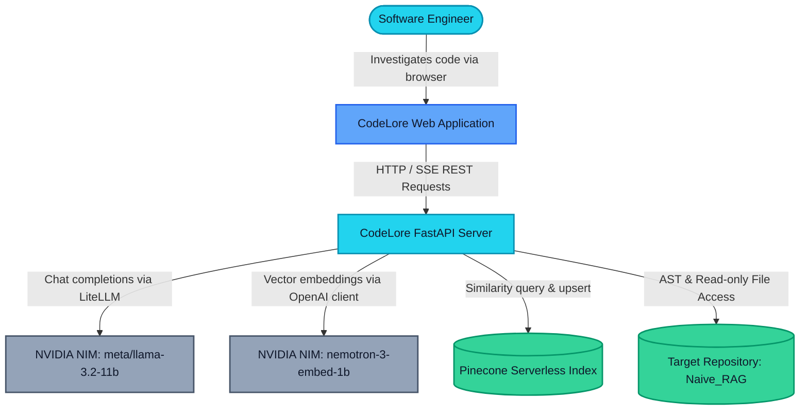
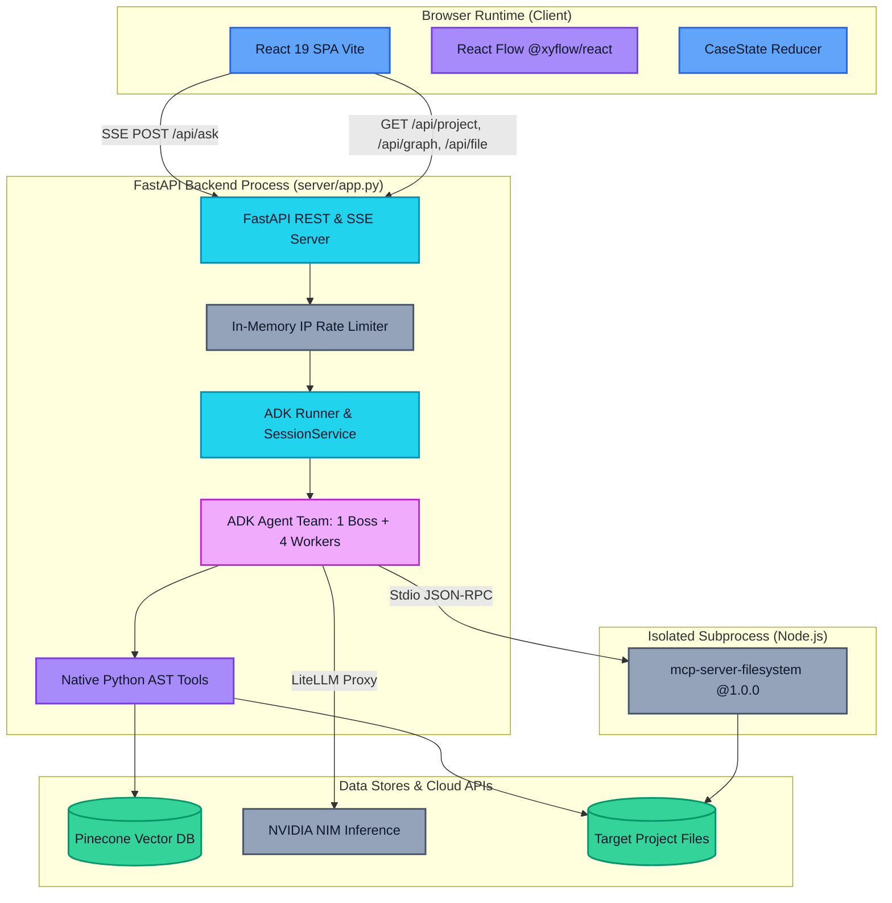
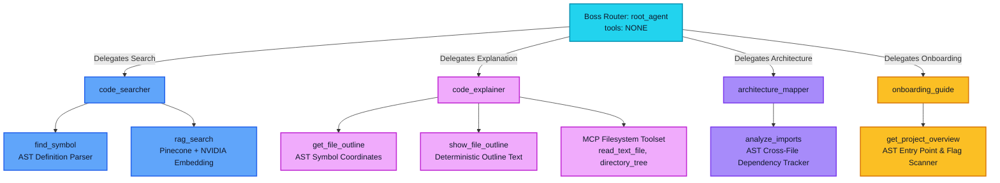
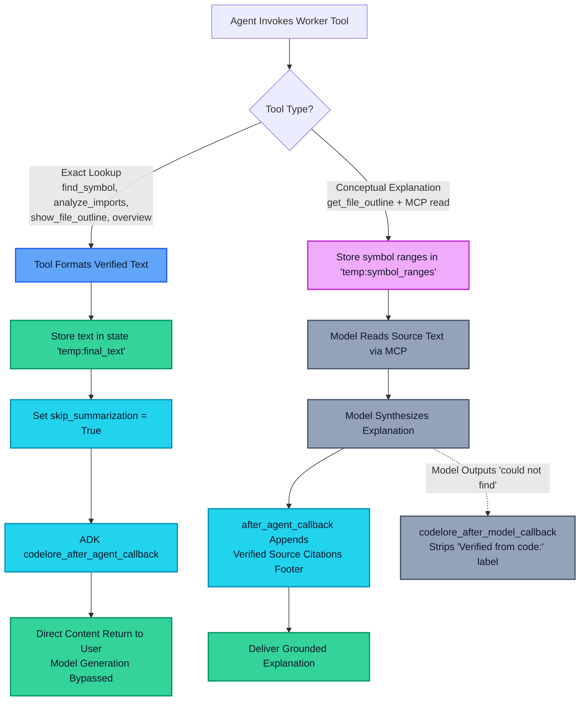
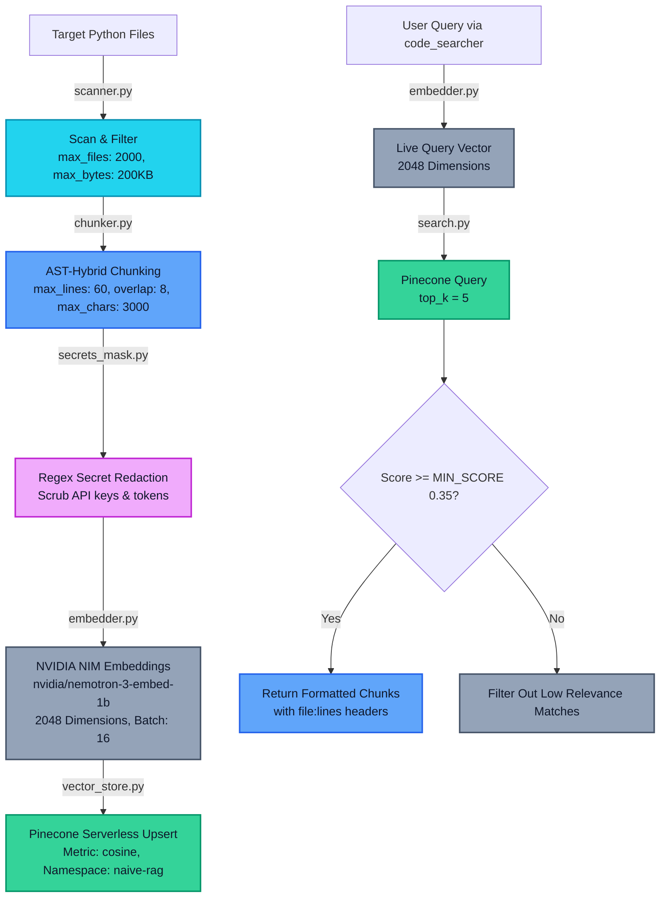
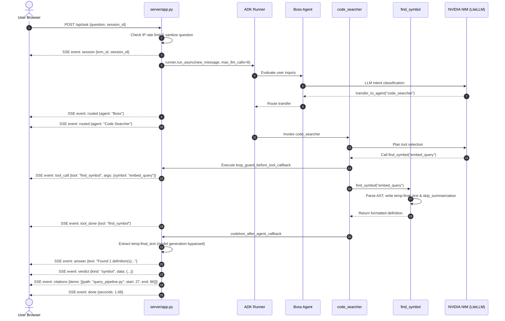
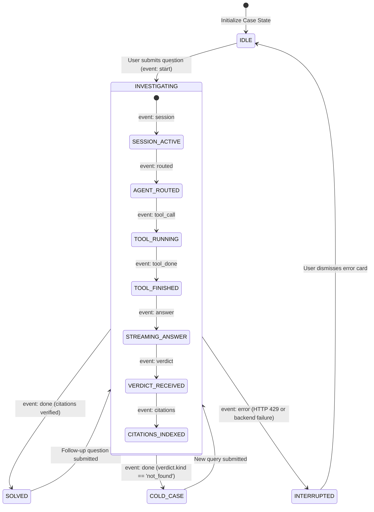

# System Architecture — CodeLore

> CodeLore implements a multi-agent orchestration architecture where a zero-tool routing coordinator delegates queries to specialized Python AST and MCP workers, delivering verified line-number citations through deterministic state callbacks.

---

## Contents
- [Status](#status)
- [1. System Context](#1-system-context)
- [2. Container & Process Architecture](#2-container--process-architecture)
- [3. Multi-Agent Team Structure](#3-multi-agent-team-structure)
- [4. Deterministic Answer Delivery vs Model Path](#4-deterministic-answer-delivery-vs-model-path)
- [5. Reliability Guards & Execution Boundaries](#5-reliability-guards--execution-boundaries)
- [6. RAG Indexing & Retrieval Pipeline](#6-rag-indexing--retrieval-pipeline)
- [7. End-to-End Query Sequence](#7-end-to-end-query-sequence)
- [8. Case Turn Lifecycle State Machine](#8-case-turn-lifecycle-state-machine)
- [9. Repository Structure](#9-repository-structure)
- [10. Architecture Decision Records (ADRs)](#10-architecture-decision-records-adrs)
- [11. Cross References](#11-cross-references)

---

## Status

| Architectural Component | Status | Implementation Details |
| :--- | :---: | :--- |
| **Google ADK Orchestration** | **Built** | `google-adk==2.12.0` with `InMemorySessionService` and `RunConfig(max_llm_calls=8)`. |
| **Boss Router Agent** | **Built** | `LlmAgent(name="boss", tools=[])` routing via agent transfers only. |
| **Worker Isolation Rules** | **Built** | `disallow_transfer_to_parent=True` and `disallow_transfer_to_peers=True` on all workers. |
| **Deterministic Answer Callback** | **Built** | `codelore_after_agent_callback` delivering `temp:final_text` directly to users. |
| **Model Output Sanitizer** | **Built** | `codelore_after_model_callback` stripping "Verified from code:" on not-found responses. |
| **Loop Guard Callback** | **Built** | `loop_guard_before_tool_callback` blocking >= 2 calls per tool or >= 1 identical call. |
| **MCP Subprocess Toolset** | **Built** | `@modelcontextprotocol/server-filesystem@1.0.0` over Stdio with read-only filter. |
| **Custom RAG Engine** | **Built** | AST-hybrid chunking, regex secret masking, NVIDIA embeddings, Pinecone serverless. |
| **FastAPI SSE Streaming** | **Built** | `sse-starlette==3.5.0` delivering live `routed`, `tool_call`, `verdict`, `citations`. |
| **React 19 Case Investigation UI** | **Built** | React 19 + Tailwind CSS + `@xyflow/react` interactive dependency graph. |
| **Distributed Session Store** | **Planned** | Redis-backed session service for horizontal API container scaling (Phase 11). |
| **Background Indexing Queue** | **Planned** | Celery/Redis asynchronous job workers for multi-repository indexing (Phase 12). |

---

## 1. System Context

The system context diagram illustrates how external human actors and cloud APIs interact with the CodeLore boundary.


*Figure 1 - CodeLore system context diagram showing user interactions and third-party cloud boundaries.*

---

## 2. Container & Process Architecture

CodeLore separates responsibilities across decoupled runtime processes, eliminating monolith bottlenecks while enforcing least-privilege security boundaries.


*Figure 2 - Container and process breakdown showing process isolation between FastAPI, Node.js MCP, and external cloud services.*

---

## 3. Multi-Agent Team Structure

CodeLore organizes intelligence hierarchically. The **Boss** coordinates routing based on intent, while four specialized workers execute focused domain tasks. Workers cannot route back to the Boss or to peers, preventing cyclical delegation loops.


*Figure 3 - Google ADK agent hierarchy, worker assignments, and native tool registrations.*

### Worker Configuration Details
- **`Boss` (`root_agent`)**: Registered with `tools=[]`. Instructed to evaluate query classification rules and issue a single `transfer_to_agent` directive without synthesizing direct prose.
- **`code_searcher`**: Holds exact AST symbol lookup (`find_symbol`) and semantic vector retrieval (`rag_search`). Enforces automatic string-to-int type coercion on `top_k`.
- **`code_explainer`**: Holds AST outline extractors and the external MCP filesystem toolset with a strict read-only filter:
  `["read_text_file", "list_directory", "directory_tree", "search_files", "get_file_info"]`.
- **`architecture_mapper`**: Holds `analyze_imports` to inspect target import statements and detect both internal module references and external dependencies.
- **`onboarding_guide`**: Holds `get_project_overview` to identify runnable entry points (`__main__` guards + `argparse`) and generate command-line run instructions.

---

## 4. Deterministic Answer Delivery vs Model Path

### Why the Deterministic Path Was Necessary
During live empirical evaluations against `Naive_RAG`, the compact 11B parameter chat model (`meta/llama-3.2-11b-vision-instruct`) repeatedly ignored accurate tool outputs. For example, when `find_symbol` returned `query_pipeline.py:27-86` for `embed_query`, the model failed to cite the code coordinates, initiated up to 15 repetitive hallucination loops, or issued false denials (*"I could not find that in this codebase"*). Prompt engineering alone failed (**0 / 3 passed** in `eval_runs/re_eval_after_fix.md`).

To guarantee 100% citation reliability without paying for large, expensive proprietary models, CodeLore bypasses model text synthesis for exact lookups.


*Figure 4 - Dual answer delivery paths: deterministic callback bypass versus grounded model synthesis.*

---

## 5. Reliability Guards & Execution Boundaries

CodeLore enforces strict defensive boundaries at every stage of the execution lifecycle to prevent infinite loops, rate limit exhaustions, and remote API hangs.

```mermaid
flowchart LR
    classDef boss fill:#22d3ee,stroke:#0891b2,stroke-width:2px,color:#0f172a;
    classDef searcher fill:#60a5fa,stroke:#2563eb,stroke-width:2px,color:#0f172a;
    classDef explainer fill:#f0abfc,stroke:#c026d3,stroke-width:2px,color:#0f172a;
    classDef mapper fill:#a78bfa,stroke:#7c3aed,stroke-width:2px,color:#0f172a;
    classDef guide fill:#fbbf24,stroke:#d97706,stroke-width:2px,color:#0f172a;
    classDef external fill:#94a3b8,stroke:#475569,stroke-width:2px,color:#0f172a;
    classDef datastore fill:#34d399,stroke:#059669,stroke-width:2px,color:#0f172a;

    subgraph Edge ["1. Edge Boundary"]
        G1[IP Rate Limiter<br/>8 req / 10 min]:::external
        G2[Demo Code Gate<br/>X-Demo-Code header]:::external
    end

    subgraph Input ["2. Input Validation"]
        G3[Question Sanitizer<br/>Strip control chars<br/>Max 500 chars]:::boss
        G4[Path Security<br/>safe_resolve blocks ..]:::boss
    end

    subgraph Runtime ["3. Agent Execution Guards"]
        G5[ADK RunConfig<br/>max_llm_calls = 8]:::searcher
        G6[Loop Guard Callback<br/>Max 2 calls/tool<br/>Max 1 identical args]:::explainer
        G7[LiteLLM Config<br/>timeout = 90s<br/>num_retries = 1]:::external
    end

    Edge --> Input --> Runtime
```


*Figure 5 - Layered reliability guards protecting client inputs, tool calls, and model communication.*

---

## 6. RAG Indexing & Retrieval Pipeline

The RAG engine is built from scratch using standard Python libraries, avoiding heavy third-party framework dependencies.


*Figure 6 - End-to-end RAG architecture: AST-hybrid indexing and calibrated similarity retrieval.*

---

## 7. End-to-End Query Sequence

The sequence diagram below tracks the lifecycle of a user inquiry submitted to `/api/ask`.


*Figure 7 - Sequence of operations for a symbol lookup from HTTP dispatch to SSE citation delivery.*

---

## 8. Case Turn Lifecycle State Machine

Each case turn in the browser client evolves through a deterministic finite state machine managed by `sseReducer.ts`.


*Figure 8 - State transitions of a single investigation turn within the React client.*

---

## 9. Repository Structure

The physical directory tree reflects clean boundaries between agent configuration, tools, RAG logic, backend server, and frontend client:

```text
d:\CodeLore\codelore
├── code_helper/                   # Core agent package and orchestration logic
│   ├── rag/                       # Custom RAG engine (scanner, chunker, embedder, vector store)
│   ├── tools/                     # Native AST analysis tools and path safety helpers
│   ├── agent.py                   # ADK agent definitions, LiteLLM config, and callbacks
│   ├── index_codebase.py          # Standalone CLI indexing pipeline
│   ├── mcp_config.py              # Stdio MCP filesystem toolset builder with sanitization
│   ├── prompts.py                 # System instructions and routing directives for all agents
│   └── settings.py                # Dataclass configuration loader reading code_helper/.env
├── docs/                          # Presentation-quality technical documentation & reports
│   ├── diagrams/                  # Rendered SVG architecture and flow diagrams
│   ├── ARCHITECTURE.md            # How CodeLore is built and organized
│   ├── MVP_TECH.md                # Technology stack, API specs, and runbook
│   ├── PRD.md                     # Product requirements and evaluation metrics
│   └── SYSTEM_DESIGN.md           # Scalability, threat model, and reliability engineering
├── eval_runs/                     # Historical benchmark runs, calibration logs, and transcripts
├── frontend/                      # React 19 single-page client
│   ├── e2e/                       # Playwright integration test suite
│   ├── src/                       # UI components, pages, SSE reducer, and API client
│   └── package.json               # Frontend dependencies and test scripts
├── scripts/                       # Maintenance scripts and offline tool smoke test suites
├── server/                        # FastAPI application and SSE streaming endpoints
│   └── app.py                     # API routing, rate limiting, and ADK event generator
├── tests/                         # Pytest unit and integration test suite
├── AGENT_RULES.md                 # Rules of engagement for developer agents
├── pytest.ini                     # Pytest configuration and marker declarations
├── README.md                      # Primary project readme and overview
└── requirements.txt               # Exact pinned Python dependencies
```

---

## 10. Architecture Decision Records (ADRs)

### ADR-01: Google ADK Orchestration with LiteLLM Proxy
- **Context**: CodeLore requires multi-agent delegation, event streaming, session state management, and support for upstream NVIDIA NIM endpoints without vendor lock-in.
- **Decision**: Adopt Google Agent Development Kit (`google-adk==2.12.0`) coupled with `litellm==1.105.1` to access `meta/llama-3.2-11b-vision-instruct` via OpenAI-compatible endpoints.
- **Consequence**: Provides native hierarchical routing, clean callbacks (`before_tool_callback`, `after_agent_callback`), and standardized session state without the bloat of multi-framework libraries.

### ADR-02: Zero-Tool Boss Router
- **Context**: When routing coordinators have access to analysis tools, small LLMs frequently attempt to answer queries directly, resulting in confused context and redundant tool calls.
- **Decision**: Configure `Boss` (`root_agent`) with `tools=[]`, restricting its capability strictly to `transfer_to_agent`.
- **Consequence**: Eliminates coordinator hallucinations; 100% of tool executions are strictly isolated within the assigned specialist worker.

### ADR-03: Deterministic Tool State Answers (`temp:final_text`)
- **Context**: The 11B parameter chat model ignored valid tool outputs for symbol and import lookups, initiating repetitive retrieval loops or false denials.
- **Decision**: Exact lookup tools store copy-ready citations into `tool_context.state["temp:final_text"]` and set `skip_summarization = True`. A shared callback (`codelore_after_agent_callback`) delivers this text directly.
- **Consequence**: Guaranteed 100% accurate, instant responses for symbol definitions, file outlines, and import maps without LLM synthesis errors.

### ADR-04: AST-Hybrid Chunking over Fixed Character Slicing
- **Context**: Standard sliding-window character chunking splits Python functions across chunk boundaries, severing function signatures from their bodies and ruining citation accuracy.
- **Decision**: Implement `ast_hybrid` chunking in `code_helper/rag/chunker.py`, grouping code by top-level AST function and class nodes with bounded fallback windows (max 60 lines, 8-line overlap).
- **Consequence**: Chunks retain complete semantic units, allowing vector search citations to reference valid, unbroken function boundaries.

### ADR-05: Framework-Free Custom RAG Pipeline
- **Context**: Complex RAG frameworks (LangChain, LlamaIndex) introduce heavy dependency graphs, rapid API breaking changes, and opaque abstractions.
- **Decision**: Write the RAG pipeline using pure standard Python, the official `openai` client (for NVIDIA NIM embeddings), and the official `pinecone` client.
- **Consequence**: Full transparency, zero dependency conflicts, and sub-18s test suite execution.

### ADR-06: Server-Sent Events (SSE) over WebSockets
- **Context**: The web UI requires real-time streaming of multi-agent turns, tool calls, and partial responses.
- **Decision**: Use HTTP Server-Sent Events via `sse-starlette` rather than bidirectional WebSockets.
- **Consequence**: Native HTTP compatibility, automatic browser reconnection, zero custom socket handshake logic, and seamless proxy traversal on platforms like Render and Vercel.

### ADR-07: React Flow for Dependency Mapping
- **Context**: Understanding cross-file imports requires spatial comprehension that text tables cannot provide.
- **Decision**: Integrate `@xyflow/react` (`^12.12.0`) on the frontend to visualize AST-generated nodes and edges.
- **Consequence**: Interactive, draggable dependency maps directly synchronized with file line highlights.

### ADR-08: Isolated Read-Only MCP Filesystem Process
- **Context**: The `code_explainer` agent needs deep file reading, but custom filesystem tools risk security escapes or accidental writes.
- **Decision**: Spawn the official `@modelcontextprotocol/server-filesystem@1.0.0` subprocess via ADK's `McpToolset`, filtered strictly to read-only tools and stripped of host environment API keys.
- **Consequence**: Standardized MCP compliance with strict isolation protecting sensitive host configuration files.

---

## 11. Cross References

- Product Requirements & Evaluation Metrics: [docs/PRD.md](file:///d:/CodeLore/codelore/docs/PRD.md)
- MVP Features, APIs & Local Runbook: [docs/MVP_TECH.md](file:///d:/CodeLore/codelore/docs/MVP_TECH.md)
- Scalability, Threat Model & System Design: [docs/SYSTEM_DESIGN.md](file:///d:/CodeLore/codelore/docs/SYSTEM_DESIGN.md)
- Technical Post-Mortem on Small-Model Looping: [docs/problem_and_fix.md](file:///d:/CodeLore/codelore/docs/problem_and_fix.md)
- Empirical Known Limitations & Bottlenecks: [docs/known_limitations.md](file:///d:/CodeLore/codelore/docs/known_limitations.md)
- Verbatim Sample Questions and Answers: [docs/sample_qa.md](file:///d:/CodeLore/codelore/docs/sample_qa.md)
