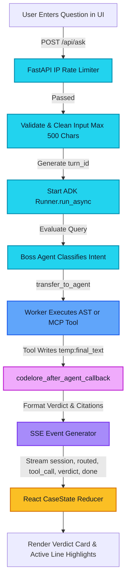

# MVP Specification & Technology Stack — CodeLore

> CodeLore MVP delivers deterministic code search, AST-based symbol definition, cross-file import tracking, and deep file explanations across Python codebases via a modern React 19 interface and FastAPI SSE backend.

---

## Contents
- [Status](#status)
- [1. MVP Scope: What It Does Today vs Left Out](#1-mvp-scope-what-it-does-today-vs-left-out)
- [2. Technology Stack & Versions](#2-technology-stack--versions)
- [3. MVP Request Flow](#3-mvp-request-flow)
- [4. REST API Reference](#4-rest-api-reference)
- [5. Server-Sent Events (SSE) Reference](#5-server-sent-events-sse-reference)
- [6. Local Setup & Execution Guide (Windows PowerShell)](#6-local-setup--execution-guide-windows-powershell)
- [7. Test Suite Execution & Coverage](#7-test-suite-execution--coverage)
- [8. Cloud Deployment Guide (Render & Vercel)](#8-cloud-deployment-guide-render--vercel)
- [9. Known Limitations Summary](#9-known-limitations-summary)
- [10. Cross References](#10-cross-references)

---

## Status

| Capability / Area | Status | Implementation Details |
| :--- | :---: | :--- |
| **AST Symbol & Outline Analysis** | **Built** | Fully offline AST parsers returning exact line spans in `<2s`. |
| **Vector Code Search (RAG)** | **Built** | `nvidia/nemotron-3-embed-1b` + Pinecone Serverless cosine index. |
| **Read-Only MCP Filesystem** | **Built** | `@modelcontextprotocol/server-filesystem@1.0.0` over Stdio. |
| **FastAPI Backend & SSE** | **Built** | `FastAPI 0.141.1` + `sse-starlette 3.5.0` with IP rate limiting. |
| **React 19 Case Investigation UI** | **Built** | React 19 SPA with Case Board, interactive timeline, and code viewer. |
| **Interactive Import Map** | **Built** | `@xyflow/react 12.12.0` visual dependency graph. |
| **Full Offline Test Coverage** | **Built** | 106 unit tests, 85 smoke checks, 18 frontend unit tests, 5 E2E tests. |
| **Multi-Repo Workspace Support** | **Planned** | Switching between multiple indexed repositories (Phase 10). |
| **User Accounts & Cloud Auth** | **Planned** | Firebase / OAuth authentication and per-user turn quotas (Phase 11). |
| **Asynchronous Job Worker** | **Planned** | Celery/Redis queue for non-blocking multi-repo indexing (Phase 12). |

---

## 1. MVP Scope: What It Does Today vs Left Out

### What the MVP Does Today
- **Multi-Agent Intent Routing**: Classifies queries across 4 specialists via `Boss` with zero coordinator tool hallucination.
- **AST Symbol Lookup**: Locates exact function and class definition boundaries (e.g. `query_pipeline.py:27-86` for `embed_query`).
- **AST Outline Extraction**: Extracts classes, methods, parameters, and docstrings for any Python file.
- **Import Dependency Mapping**: Traces cross-file imports and visualizes them on an interactive React Flow canvas.
- **Semantic Code Search**: Retrieves relevant code chunks using 2048-dimensional NVIDIA embeddings with score thresholding (`MIN_SCORE = 0.35`).
- **Standardized MCP Reading**: Inspects project file contents via read-only Node.js MCP server without exposing host secrets.
- **Deterministic Answer Delivery**: Delivers lookup results directly via ADK session state (`temp:final_text`), preventing small-model refusal loops.
- **Real-Time Turn Streaming**: Streams multi-agent timelines, tool calls, verdicts, and citations via Server-Sent Events.
- **Synchronized Evidence Viewer**: Highlights exact cited line spans with visual glows upon clicking citation chips.
- **Local Persistence**: Stores recent investigation cases in browser `localStorage`.

### What Is Deliberately Left Out of the MVP
- **Code Modification & Patching**: The MVP is strictly read-only. It will not write code, edit files, or open pull requests.
- **Target Script Execution**: CodeLore analyzes ASTs and text; it never executes `eval()`, `exec()`, or target entry scripts.
- **Multi-Tenant Cloud Workspace**: The MVP is configured for a single local target directory at a time (`TARGET_PROJECT_PATH`).
- **Non-Python Languages**: Language parsing is tailored specifically for Python (`.py`) files.
- **User Accounts & Database Storage**: No database migrations or persistent cloud user sessions exist in the MVP.

---

## 2. Technology Stack & Versions

All versions listed below are exact specifications copied from `requirements.txt` and `frontend/package.json`.

| Layer | Technology | Exact Version | Rationale & Selection Criteria |
| :--- | :--- | :---: | :--- |
| **Multi-Agent Orchestration** | `google-adk` | `2.12.0` | Hierarchical agent delegation, clean callback architecture, and built-in session state management without third-party framework overhead. |
| **Model Access & Proxy** | `litellm` | `1.105.1` | Universal model routing and OpenAI-compatible client proxying to upstream NVIDIA NIM endpoints with timeout/retry control. |
| **LLM Inference Provider** | `openai` | `2.54.0` | Official client interface used for NVIDIA NIM chat completions (`meta/llama-3.2-11b-vision-instruct`). |
| **Code Embeddings** | NVIDIA NIM API | `nvidia/nemotron-3-embed-1b` | High-accuracy 2048-dimensional embedding model optimized for technical documentation and source code. |
| **Vector Database** | `pinecone` | `10.0.0` | Serverless managed vector index using cosine similarity distance and isolated namespaces. |
| **Model Context Protocol** | `mcp` | `2.3.0` | Official Python MCP SDK for managing standardized subprocess toolsets. |
| **MCP Subprocess Server** | `@modelcontextprotocol/server-filesystem` | `1.0.0` | Official Stdio filesystem server executed via `npx` with strict read-only tool filtering. |
| **API Web Framework** | `fastapi` | `0.141.1` | High-performance asynchronous Python REST framework with automatic OpenAPI documentation and strict Pydantic validation. |
| **ASGI Web Server** | `uvicorn[standard]` | `0.54.0` | Robust ASGI server running FastAPI with event loop optimizations. |
| **Streaming Engine** | `sse-starlette` | `3.5.0` | Server-Sent Events integration for Starlette/FastAPI supporting long-lived HTTP event streams. |
| **Environment Management**| `python-dotenv` | `1.2.4` | Strictly isolates configuration variables within `code_helper/.env`. |
| **Backend Unit Testing** | `pytest` | `9.1.1` | Industry-standard test runner with custom markers (`live`, `live_mcp`) and fast execution. |
| **Frontend Core Library** | `react` / `react-dom` | `19.2.8` | Latest React framework with compiler optimizations and modern hook architecture. |
| **Client Routing** | `react-router-dom` | `7.18.4` | Declarative client-side routing across Case Board, Files, and Start Here views. |
| **Frontend Bundler** | `vite` | `8.3.0` | Lightning-fast development server with instant HMR and optimized Rollup production builds. |
| **Type Checking** | `typescript` | `~6.0.2` | Complete type safety across SSE event schemas, API contracts, and UI components. |
| **Styling Engine** | `tailwindcss` | `3.4.19` | Utility-first CSS engine with dark mode styling and theme variables. |
| **CSS Post-Processing** | `postcss` / `autoprefixer` | `8.5.30` / `10.6.1`| Standard CSS transformation pipeline for cross-browser compatibility. |
| **Graph Visualization** | `@xyflow/react` | `12.12.0` | Interactive canvas engine rendering project import graphs with smooth panning and zooming. |
| **Iconography** | `lucide-react` | `1.57.0` | Comprehensive, consistent icon system for detective case elements and file types. |
| **Markdown Rendering** | `react-markdown` / `remark-gfm` | `10.1.0` / `4.0.1` | Secure GitHub Flavored Markdown rendering with code fences and table formatting. |
| **Frontend Unit Testing** | `vitest` | `5.0.5` | Native Vite test runner executing component and reducer tests in milliseconds. |
| **End-to-End Testing** | `@playwright/test` | `1.64.1` | Multi-browser automation suite testing real HTTP and mock SSE integration flows. |
| **Fast Linter** | `oxlint` | `1.81.0` | Ultra-fast Rust-based linter ensuring clean frontend code. |

---

## 3. MVP Request Flow


*Figure 1 - High-level MVP request flow from client submission to streaming UI response.*

---

## 4. REST API Reference

The backend API is served by `server/app.py`. All responses use strict JSON or standard SSE formats.

| Method | Endpoint Path | Purpose | Query / Body Parameters | Response Shape (JSON) | Possible Error Status Codes |
| :--- | :--- | :--- | :--- | :--- | :--- |
| `GET` | `/api/health` | Service health check | None | `{"ok": true}` | None |
| `GET` | `/api/project` | Lists project files, line counts, and git commit | None | `{"name": str, "commit": str \| null, "files": [{"path": str, "lines": int, "kind": "py"\|"md"\|"txt"\|"data"}], "total_py_lines": int}` | `500 Internal Server Error` |
| `GET` | `/api/file` | Reads source file lines with secrets masked | `path`: string *(required, relative)* | `{"path": str, "lines": [str, ...]}` | `400 Bad Request` (traversal, empty)<br/>`403 Forbidden` (`.env`, `.key`)<br/>`404 Not Found`<br/>`413 Payload Too Large` (>300KB) |
| `GET` | `/api/outline` | Returns AST classes, methods, and functions | `path`: string *(required, Python file)* | `{"path": str, "items": [{"name": str, "kind": "class"\|"method"\|"function", "params": str, "start": int, "end": int, "doc": str}]}` | `400 Bad Request` (non-py, syntax error)<br/>`404 Not Found` |
| `GET` | `/api/graph` | Builds cross-file AST import dependency graph | None | `{"nodes": [{"id": str, "lines": int}], "edges": [{"from": str, "to": str, "line": int, "symbols": [str]}]}` | `500 Internal Server Error` |
| `GET` | `/api/overview`| Extracts primary entry point, commands & stages | None | `{"entry_point": str, "also_runnable": [str], "commands": [str], "stages": [str], "reading_order": [{"path": str, "doc": str}], "data_files": [str], "dependency_files": [str], "docs": [str]}` | `500 Internal Server Error` |
| `POST` | `/api/ask` | Initiates multi-agent investigation turn | JSON Body: `{"question": str, "session_id": Optional[str]}` | Server-Sent Event Stream (`text/event-stream`) | `400 Bad Request` (empty, >500 chars)<br/>`403 Forbidden` (bad `X-Demo-Code`)<br/>`429 Too Many Requests` (rate limit) |

---

## 5. Server-Sent Events (SSE) Reference

The `/api/ask` endpoint streams events as JSON-encoded payloads adhering to the following specification:

| Event Name | Payload Fields | Emission Timing | Client Action (`sseReducer.ts`) |
| :--- | :--- | :--- | :--- |
| `session` | `turn_id`, `session_id` | Emitted immediately upon request acceptance. | Initializes turn state and stores session identifier. |
| `routed` | `turn_id`, `agent` | Emitted when an agent (e.g. `Boss`, `code_searcher`) begins processing. | Adds routing milestone to investigation timeline and updates `activeAgent`. |
| `tool_call` | `turn_id`, `agent`, `tool`, `args` | Emitted prior to executing an agent tool (arguments sanitized of secrets). | Renders running tool badge on timeline with parameter summary. |
| `tool_done` | `turn_id`, `agent`, `tool` | Emitted immediately after tool execution completes. | Marks tool milestone as completed and calculates execution duration. |
| `answer` | `turn_id`, `agent`, `text` | Emitted when partial or full text chunks are produced. | Appends text into active answer buffer. |
| `verdict` | `turn_id`, `agent`, `kind`, `data`, `text`, `citations`, `sources` | Emitted when final structured judgment is rendered (`symbol`, `outline`, `imports`, `overview`, `text`, `not_found`). | Renders dedicated `StructuredVerdictCard` and exposes evidence chips. |
| `citations` | `turn_id`, `items`: `[{"path", "start", "end"}]` | Emitted after verifying citations against real target file bounds. | Populates Evidence Panel and activates line number chips. |
| `done` | `turn_id`, `seconds` | Emitted when the investigation turn completes successfully. | Finalizes turn status to `completed` and records total execution time. |
| `error` | `turn_id`, `message`, `code` | Emitted upon unexpected backend exceptions or timeouts. | Updates turn status to `error` and displays the Lore error card. |

---

## 6. Local Setup & Execution Guide (Windows PowerShell)

Follow these exact steps to run CodeLore locally on Windows.

### 1. Prerequisites
- **Python**: Python 3.11 or higher.
- **Node.js & npm**: Node.js v18+ installed on your system `PATH` (required for `npx` MCP server).
- **Git**: Git installed on your system `PATH`.

### 2. Virtual Environment & Dependencies
```powershell
# Navigate to the repository root
cd d:\CodeLore\codelore

# Create virtual environment
python -m venv .venv

# Activate virtual environment
.\.venv\Scripts\Activate.ps1

# Install backend dependencies
pip install -r requirements.txt

# Install frontend dependencies
cd frontend
npm install
cd ..
```

### 3. Environment Variables
Create `code_helper/.env` (copy from `.env.example` if available). **Never commit `.env` to Git.**

Required environment variable names:
```text
NVIDIA_API_KEY          # Upstream NVIDIA NIM key for chat & embeddings
NVIDIA_BASE_URL         # Base URL for NVIDIA NIM (https://integrate.api.nvidia.com/v1)
NVIDIA_CHAT_MODEL       # meta/llama-3.2-11b-vision-instruct
NVIDIA_EMBED_MODEL      # nvidia/nemotron-3-embed-1b
PINECONE_API_KEY        # API key for Pinecone vector database
PINECONE_INDEX_NAME     # Name of Pinecone index (e.g. codelore-index)
PINECONE_CLOUD          # Cloud provider (e.g. aws)
PINECONE_REGION         # Cloud region (e.g. us-east-1)
PINECONE_NAMESPACE      # Namespace for target project (default: naive-rag)
TARGET_PROJECT_PATH     # Absolute path to target repository (e.g. D:\CodeLore\targets\Naive_RAG)
```

Optional server overrides:
```text
FRONTEND_ORIGINS        # Allowed CORS origins (default: http://localhost:5173)
DEMO_CODE               # Optional security token required via X-Demo-Code header
PORT                    # Server listening port (default: 8000)
```

### 4. Index the Target Codebase
Before querying via semantic search, index the target repository into Pinecone:
```powershell
python code_helper/index_codebase.py
```
*(Confirm with `y` when prompted, or pass `--yes` for automated environments).*

### 5. Run the Application
Open two separate PowerShell terminals:

**Terminal 1 — Backend API Server:**
```powershell
cd d:\CodeLore\codelore
.\.venv\Scripts\Activate.ps1
uvicorn server.app:app --host 0.0.0.0 --port 8000 --reload
```
*Health check URL*: `http://localhost:8000/api/health`

**Terminal 2 — Frontend Client:**
```powershell
cd d:\CodeLore\codelore\frontend
npm run dev
```
*Application URL*: Open `http://localhost:5173` in your browser.

---

## 7. Test Suite Execution & Coverage

CodeLore maintains comprehensive offline and integration test coverage:

```
+----------------------------------------------------------------------------------------------------+
| TEST SUITE SUMMARY & REAL MEASUREMENTS                                                             |
+--------------------------+-----------------------+-----------------------------+-------------------+
| Suite                    | Execution Command     | Coverage Scope              | Measured Result   |
+--------------------------+-----------------------+-----------------------------+-------------------+
| Backend Unit & Integr.   | python -m pytest -q   | Agent structure, tools, RAG,| 106 passed,       |
|                          |                       | AST parsers, settings, MCP  | 4 skipped (~18s)  |
+--------------------------+-----------------------+-----------------------------+-------------------+
| Offline Tool Smoke Test  | python scripts/       | Exhaustive AST checks on all| 85 checks run,    |
|                          | tool_smoke_test.py    | 5 files: symbols, outlines  | 85 PASS, 0 FAIL   |
+--------------------------+-----------------------+-----------------------------+-------------------+
| Frontend Unit Tests      | npm test (in frontend)| Vitest: SSE reducer, case   | 4 test files,     |
|                          |                       | state, citation parsing     | 18 PASS (2.14s)   |
+--------------------------+-----------------------+-----------------------------+-------------------+
| End-to-End Tests         | npx playwright test   | Playwright: /board, /files, | 5 scenarios PASS  |
|                          |                       | /start, SSE stream, 429     | (100% pass rate)  |
+--------------------------+-----------------------+-----------------------------+-------------------+
```

---

## 8. Cloud Deployment Guide (Render & Vercel)

CodeLore is architected for zero-friction cloud deployment using **Render** for the containerized FastAPI backend and **Vercel** for the static React single-page frontend.

### A. Backend on Render (Docker Web Service)
- **Deployment Type**: Docker Web Service.
- **Root Directory**: `.` (Repository root).
- **Docker Command**: `uvicorn server.app:app --host 0.0.0.0 --port $PORT`
- **Environment Variables**: Configure all variable names listed in [Section 6](#3-environment-variables). Set `FRONTEND_ORIGINS` to your production Vercel domain (e.g. `https://codelore.vercel.app`).
- **Free-Tier Note**: Render free web services spin down after 15 minutes of inactivity. The initial cold-start request can take ~50 seconds to boot.

### B. Frontend on Vercel (Static SPA)
- **Framework Preset**: Vite.
- **Root Directory**: `frontend`.
- **Build Command**: `npm run build` (`tsc -b && vite build`).
- **Output Directory**: `dist`.
- **Environment Variables**:
  `VITE_API_URL`: URL of your deployed Render backend (e.g. `https://codelore-api.onrender.com`).
  `VITE_DEMO_CODE`: Matches `DEMO_CODE` on Render if demo gating is active.

---

## 9. Known Limitations Summary

For full empirical data and failure transcripts, see [docs/known_limitations.md](file:///d:/CodeLore/codelore/docs/known_limitations.md). Top 5 summarized:

1. **Free-Tier NIM Inference Latency**: Remote API queuing on NVIDIA's free tier can occasionally cause response latency spikes of several minutes under high load.
2. **Compact Model Synthesis Limits**: The 11B parameter chat model struggles to extract embedded variable assignments from dense text passages (e.g. missing `top_k = 3` in `EVAL_01`).
3. **AST Classifier External Artifact**: `analyze_imports` classifies locally imported functions as "Third-party / External" when they do not map to standalone filenames, though the line citation is 100% correct.
4. **Narrow Vector Retrieval Score Margin**: Valid query chunks scored between `0.36` and `0.42` in calibration; with `MIN_SCORE = 0.35`, the margin separating true hits from the highest false-positive (`0.3016`) is ~0.05.
5. **Subprocess MCP Scope on Environment Files**: The official MCP filesystem server does not enforce file extension filters and can read `.env` files if placed directly in its root; production deployments must mount a sanitized copy.

---

## 10. Cross References

- Product Requirements & User Personas: [docs/PRD.md](file:///d:/CodeLore/codelore/docs/PRD.md)
- Complete System Architecture & ADRs: [docs/ARCHITECTURE.md](file:///d:/CodeLore/codelore/docs/ARCHITECTURE.md)
- System Design for Scale, Reliability & Safety: [docs/SYSTEM_DESIGN.md](file:///d:/CodeLore/codelore/docs/SYSTEM_DESIGN.md)
- Engineering Problem & Fix Deep Dive: [docs/problem_and_fix.md](file:///d:/CodeLore/codelore/docs/problem_and_fix.md)
- Full Limitations & Benchmark Analysis: [docs/known_limitations.md](file:///d:/CodeLore/codelore/docs/known_limitations.md)
- Verified Evaluation Transcripts: [docs/sample_qa.md](file:///d:/CodeLore/codelore/docs/sample_qa.md)
