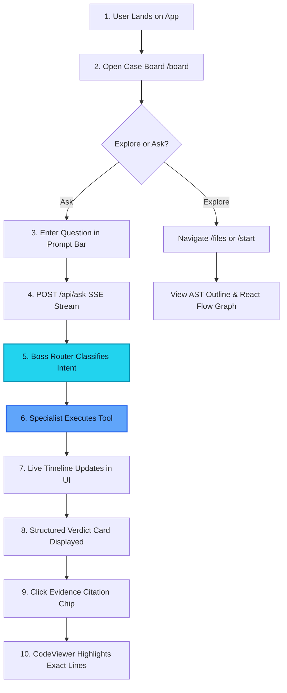

# Product Requirements Document (PRD) — CodeLore

> CodeLore is a multi-agent developer assistant that makes unfamiliar Python repositories instantly understandable by answering architecture, symbol, and workflow questions with verified line-number citations.

---

## Contents
- [Status](#status)
- [1. Problem Statement](#1-problem-statement)
- [2. User Personas](#2-user-personas)
- [3. Goals and Non-Goals](#3-goals-and-non-goals)
- [4. User Stories & Acceptance Criteria](#4-user-stories--acceptance-criteria)
- [5. Feature Matrix](#5-feature-matrix)
- [6. User Journey](#6-user-journey)
- [7. Measured Success Metrics](#7-measured-success-metrics)
- [8. Risk Analysis & Mitigations](#8-risk-analysis--mitigations)
- [9. Release Roadmap](#9-release-roadmap)
- [10. Cross References](#10-cross-references)

---

## Status

| Capability / Area | Status | Notes |
| :--- | :---: | :--- |
| **Multi-Agent Intent Routing** | **Built** | `Boss` routes queries across 4 specialists with zero direct tool execution. |
| **AST Symbol Definition Lookup** | **Built** | Exact line spans via Python AST parsing (`find_symbol`). |
| **Import Dependency Mapping** | **Built** | Cross-file dependency tracking and React Flow graph (`analyze_imports`). |
| **AST File Outlines** | **Built** | Class and function extraction with line numbers (`get_file_outline`, `show_file_outline`). |
| **Semantic Code Search (RAG)** | **Built** | Vector search over AST-hybrid chunks using NVIDIA embeddings and Pinecone. |
| **Filesystem Inspection (MCP)** | **Built** | Read-only file inspection via `@modelcontextprotocol/server-filesystem@1.0.0`. |
| **Interactive Case UI** | **Built** | Web interface with live timeline, evidence chips, and code viewer. |
| **Deterministic Answer Callback** | **Built** | Bypasses small-model hallucinations via `temp:final_text` session storage. |
| **External Repo Git Importer** | **Planned** | Phase 10: Automatic cloning and sanitizing of arbitrary repositories. |
| **User Authentication & Quotas** | **Planned** | Phase 11: OAuth/Firebase accounts with per-user usage limits. |
| **Background Indexing Queue** | **Planned** | Phase 12: Asynchronous task workers and git commit webhook indexing. |
| **Sandboxed Code Editing** | **Planned** | Phase 13: Isolated container execution for proposed code modifications. |

---

## 1. Problem Statement

Understanding an unfamiliar Python codebase is slow, disorienting, and cognitively exhausting. When developers, students, or security auditors encounter a new repository, they struggle with three fundamental friction points:

1. **Lost in File Navigation**: Finding the true architectural entry point, CLI invocation flags, or the core business logic often requires reading hundreds of lines of boilerplate.
2. **Untrusted Chatbot Hallucinations**: Standard LLM chat tools generate plausible explanations but invent imaginary function names, hallucinate parameters, or cite non-existent line numbers.
3. **No Direct Grounding to Code Lines**: Even when an answer is accurate, developers must manually open their editor and hunt down where the logic actually lives.

CodeLore solves this by combining deterministic Abstract Syntax Tree (AST) tools, read-only Filesystem Model Context Protocol (MCP), and vector retrieval into an interactive multi-agent system. Every answer is backed by verified file and line citations clickable directly in the browser.

---

## 2. User Personas

| Persona | Role & Context | Primary Need | Value Delivered by CodeLore |
| :--- | :--- | :--- | :--- |
| **Maya** *(Student / Intern)* | Onboarding to an open-source project or company repository for the first time. | Needs to know where execution begins, how to run the project locally, and what files to read first. | Instant repository overview via `/start`, runnable CLI flags, and entry point detection (`main.py`). |
| **Devon** *(Senior Developer)* | Auditing an existing service to locate a specific class, function definition, or import relationship. | Needs rapid, exact symbol lookup without grepping through hundreds of files. | Instant AST-backed line locations (`file.py:start-end`) delivered in under 2 seconds. |
| **Elena** *(Mentor / Instructor)* | Reviewing student submissions or code architecture without running untrusted scripts. | Needs to inspect dependency graphs and verify module boundaries safely. | Interactive React Flow import graph (`/files` tab) and read-only MCP file inspection without code execution. |

---

## 3. Goals and Non-Goals

### Goals
- **Verified Code Citations**: Return exact line spans (e.g. `query_pipeline.py:27-86`) that match real AST nodes in the target repository.
- **Deterministic Reliability**: Ensure lookup questions (symbols, imports, outlines) never fail due to small-model refusal loops or hallucinated denials.
- **Read-Only Safety**: Inspect and parse target code without ever executing target scripts, importing target modules, or running `eval()`/`exec()`.
- **Live Observability**: Provide real-time Server-Sent Events (SSE) showing the active agent, tool calls, and execution timeline in the UI.
- **Zero Heavy Framework Lock-In**: Deliver native Google ADK orchestration without LangChain or LlamaIndex overhead.

### Non-Goals
- **Code Modification or Refactoring (MVP)**: CodeLore is strictly read-only in the current release; it does not patch, format, or write code back to disk.
- **Live Code Execution or Sandboxing (MVP)**: Target code is analyzed via AST and text inspection only; scripts are not executed in a runtime sandbox.
- **Arbitrary Language Support**: The current release focuses exclusively on Python (`.py`) codebases.
- **Enterprise Multi-Tenancy**: The MVP analyzes a designated local repository directory (`TARGET_PROJECT_PATH`) rather than multi-tenant cloud storage.

---

## 4. User Stories & Acceptance Criteria

### US-01: Case Investigation & Live Timeline (Web App)
- **As a** developer investigating a codebase question,  
- **I want to** watch the multi-agent investigation unfold live,  
- **So that** I understand which specialist was selected and what tools were run.
> **Given** I submit a question on the Case Board (`/board`),  
> **When** the backend streams SSE events,  
> **Then** the UI displays an active timeline badge showing `Boss` routing to a worker, individual `tool_call` and `tool_done` markers, and the final structured verdict card.

### US-02: Evidence Chips & Synchronized Code Highlighting (Web App)
- **As a** code reviewer reading an answer,  
- **I want to** click on a citation chip,  
- **So that** the exact referenced lines open immediately in the source viewer.
> **Given** an answer containing verified citations (e.g. `indexer.py:27-27`),  
> **When** I click the citation chip in the verdict card or Evidence Panel,  
> **Then** the Code Viewer opens `indexer.py` and scrolls to line 27 with active glowing line highlights (`L27–27`).

### US-03: Interactive Import Dependency Map (Web App)
- **As an** architect exploring codebase structure,  
- **I want to** view an interactive node-and-edge dependency graph,  
- **So that** I can see which modules depend on each other.
> **Given** I navigate to the "Import map" tab in the Evidence Panel or `/files`,  
> **When** the `/api/graph` endpoint returns project edges,  
> **Then** a React Flow canvas renders files as nodes and imports as directional edges with line labels (e.g. `indexer.py` ➔ `vector_store.py` at `L27`).

### US-04: Repository Onboarding & Start Here Guide (`onboarding_guide`)
- **As an** engineer onboarding to a repository,  
- **I want to** see runnable CLI commands, entry points, and reading order,  
- **So that** I know how to launch and navigate the project immediately.
> **Given** I open the `/start` page or ask "How do I run this project?",  
> **When** `onboarding_guide` executes `get_project_overview`,  
> **Then** the response lists the detected entry point (`main.py`), runnable CLI flags (`--index`, `--query`, `--compare`, `--mock`), and a sequence of files to read.

### US-05: Exact Symbol Definition Search (`code_searcher`)
- **As a** programmer looking for a specific function,  
- **I want to** find where a function or class is defined,  
- **So that** I can inspect its signature and parameters.
> **Given** I ask "Where is embed_query defined and what parameters does it take?",  
> **When** `code_searcher` executes `find_symbol("embed_query")`,  
> **Then** the response provides the exact file and line bounds (`query_pipeline.py:27-86`) without model hallucination.

### US-06: Deep Code Explanation with MCP Filesystem (`code_explainer`)
- **As a** developer seeking to understand complex mechanics,  
- **I want an** explanation of how a specific function operates internally,  
- **So that** I do not have to decipher the logic manually.
> **Given** I ask "Explain how build_prompt_with_context formats retrieved chunks",  
> **When** `code_explainer` reads the function source via the MCP Filesystem tool `read_text_file`,  
> **Then** the answer explains prompt construction and appends verified citation footers (`query_pipeline.py:129-176`).

---

## 5. Feature Matrix

| Feature | User Value | Status | Release Phase |
| :--- | :--- | :---: | :---: |
| **Boss Routing Agent** | Accurately directs questions to specialists without tool overhead. | **Built** | Phase 1 |
| **AST Symbol Search (`find_symbol`)** | Instant symbol location with zero hallucination. | **Built** | Phase 2 |
| **AST Outlines (`get/show_file_outline`)** | Complete class/method/function map of any Python file. | **Built** | Phase 2 |
| **Import Analysis (`analyze_imports`)** | Identifies all files importing a given module or symbol. | **Built** | Phase 2 |
| **RAG Pipeline (NVIDIA + Pinecone)** | Natural language semantic search across code chunks. | **Built** | Phase 3 |
| **Read-Only Filesystem MCP** | Standardized, sandboxed file reading via external process. | **Built** | Phase 4 |
| **Deterministic Answer Callback** | Guarantees reliable delivery of tool results. | **Built** | Phase 6 |
| **Execution Loop Guard** | Halts infinite agent re-querying within turns. | **Built** | Phase 6 |
| **FastAPI SSE Server (`/api/ask`)** | Real-time streaming of multi-agent turns. | **Built** | Phase 7 |
| **Project & Graph APIs** | Powers file trees, outlines, and dependency graphs. | **Built** | Phase 7 |
| **React 19 Case Investigation UI** | Beautiful detective-themed interface for codebase exploration. | **Built** | Phase 8 |
| **Synchronized CodeViewer** | In-browser code inspection with line highlighting. | **Built** | Phase 8 |
| **Interactive Import Map** | Drag-and-drop React Flow dependency visualization. | **Built** | Phase 8 |
| **Git Repository Auto-Importer** | Clone, scrub, and auto-index arbitrary GitHub repos. | **Planned** | Phase 10 |
| **User Authentication & Quotas** | Multi-user accounts with token limits and rate budgets. | **Planned** | Phase 11 |
| **Background Indexing Queue** | Asynchronous Celery/Redis queue for large codebases. | **Planned** | Phase 12 |
| **Sandboxed Code Editing** | Propose, patch, and test code changes in Docker containers. | **Planned** | Phase 13 |

---

## 6. User Journey


*Figure 1 - End-to-end user journey from codebase discovery to interactive evidence inspection.*

---

## 7. Measured Success Metrics

All metrics reported below reflect actual, empirical measurements recorded in repository files and test logs. Unmeasured claims have been strictly excluded.

| Metric | Measured Value | Measurement Context & Source File |
| :--- | :---: | :--- |
| **Retrieval Hit@1** | **8 / 10 (80.0%)** | Target evidence file is #1 ranked chunk on 10 answerable target queries ([eval_runs/min_score_calibration.md](file:///d:/CodeLore/codelore/eval_runs/min_score_calibration.md), [scripts/calc_hit_k.py](file:///d:/CodeLore/codelore/scripts/calc_hit_k.py)). |
| **Retrieval Hit@3** | **9 / 10 (90.0%)** | Target file appears in top 3 chunks (includes `config.py` for A3). |
| **Retrieval Hit@5** | **10 / 10 (100.0%)** | Target file appears in top 5 chunks for all 10 evaluation queries. |
| **Score Threshold Calibration** | **`MIN_SCORE = 0.35`** | Calibrated midpoint separating maximum false-positive not-found query (`0.3016`, Slack webhook) from minimum answerable code query (`0.4049`, A1 dependencies). |
| **Routing Accuracy (Held-out Unseen)** | **5 / 8 (62.5%)** | Initial held-out test suite evaluated after removing prompt contamination ([eval_runs/routing_eval_20261015_200406.md](file:///d:/CodeLore/codelore/eval_runs/routing_eval_20261015_200406.md)). |
| **Routing Accuracy (Final Eval Q1–Q5)**| **5 / 5 (100.0%)** | Measured on first 5 questions of final test suite following tie-break prompt rules ([eval_runs/final_eval_20261015_224242.md](file:///d:/CodeLore/codelore/eval_runs/final_eval_20261015_224242.md)). |
| **Offline Tool Smoke Tests** | **85 / 85 PASS (100%)** | Direct AST validation across all 5 target files and tools ([scripts/tool_smoke_test.py](file:///d:/CodeLore/codelore/scripts/tool_smoke_test.py)). |
| **Backend Test Suite** | **106 passed, 4 skipped** | Full unit and integration pytest execution completed in ~18s ([tests/](file:///d:/CodeLore/codelore/tests/)). |
| **Frontend Unit Tests** | **18 / 18 PASS (100%)** | 4 Vitest test suites covering SSE reduction, citations, and verdict fixtures ([frontend/package.json](file:///d:/CodeLore/codelore/frontend/package.json)). |
| **E2E Integration Scenarios** | **5 / 5 PASS (100%)** | Full Playwright suite verifying `/board`, `/files`, `/start`, case streaming, and 429 rate limiting ([frontend/e2e/integration.spec.ts](file:///d:/CodeLore/codelore/frontend/e2e/integration.spec.ts)). |
| **Query Latency Post-Fix (EVAL_02)** | **1.68s** (was 338.52s) | Symbol lookup speedup following deterministic callback fix ([eval_runs/re_eval_after_fix_2.md](file:///d:/CodeLore/codelore/eval_runs/re_eval_after_fix_2.md)). |
| **Query Latency Post-Fix (EVAL_05)** | **3.21s** (was 24.48s) | Import analysis speedup following deterministic callback fix. |

> [!NOTE]
> Questions 6–10 of the final evaluation run (covering out-of-scope technologies and adversarial injections) were stopped and not measured. Evaluation results on failed questions re-tested after fixes are diagnostic and do not represent a clean held-out dataset.

---

## 8. Risk Analysis & Mitigations

```
+---------------------------------------------------------------------------------------------------+
| RISK MATRIX & MITIGATION CONTROLS                                                                 |
+--------------------------+-----------------------+------------------------------------------------+
| Risk Description         | Impact & Likelihood   | Architectural Mitigation in CodeLore           |
+--------------------------+-----------------------+------------------------------------------------+
| Small Model Hallucination| High / High           | Deterministic callback (temp:final_text)       |
| & Refusal Looping        | (Observed in Phase 6) | bypasses LLM synthesis for all exact lookups.  |
+--------------------------+-----------------------+------------------------------------------------+
| Upstream Free-Tier NIM   | High / Medium         | LiteLLM timeout=90s, num_retries=1, RunConfig  |
| Queuing Delays & Hangs   | (Spikes up to 22 min) | max_llm_calls=8, SSE keep-alive heartbeats.    |
+--------------------------+-----------------------+------------------------------------------------+
| Cost & Resource Abuse    | Medium / Medium       | In-memory rate limiting (8 req / 10 min / IP)  |
| from Repeated Queries    |                       | plus optional DEMO_CODE request header check.  |
+--------------------------+-----------------------+------------------------------------------------+
| Path Traversal Attacks   | Critical / Low        | safe_resolve() rejects '..' and paths outside  |
| via Filename Parameters  |                       | target root with PathSecurityError (HTTP 400). |
+--------------------------+-----------------------+------------------------------------------------+
| Credential & Secret      | Critical / Medium     | Regex mask_secrets() scrubs keys before embed; |
| Leakage in Target Files  |                       | .env/.key/.pem files blacklisted in server.    |
+--------------------------+-----------------------+------------------------------------------------+
| MCP Subprocess Secret    | High / Low            | McpToolset passes sanitized minimal env        |
| Inheritance              |                       | (PATH, SystemRoot) excluding API keys.         |
+--------------------------+-----------------------+------------------------------------------------+
```

---

## 9. Release Roadmap

```mermaid
flowchart LR
    classDef boss fill:#22d3ee,stroke:#0891b2,stroke-width:2px,color:#0f172a;
    classDef searcher fill:#60a5fa,stroke:#2563eb,stroke-width:2px,color:#0f172a;
    classDef explainer fill:#f0abfc,stroke:#c026d3,stroke-width:2px,color:#0f172a;
    classDef mapper fill:#a78bfa,stroke:#7c3aed,stroke-width:2px,color:#0f172a;
    classDef guide fill:#fbbf24,stroke:#d97706,stroke-width:2px,color:#0f172a;
    classDef external fill:#94a3b8,stroke:#475569,stroke-width:2px,color:#0f172a;
    classDef datastore fill:#34d399,stroke:#059669,stroke-width:2px,color:#0f172a;

    subgraph Built ["Built & Verified (Phases 1-9)"]
        direction TB
        P1["Phase 1-3: Core RAG & ADK Agents"]:::boss
        P2["Phase 4-5: MCP Tools & Calibration"]:::searcher
        P3["Phase 6: Deterministic Callbacks & Loop Guard"]:::explainer
        P4["Phase 7-9: FastAPI Server, React UI & E2E Tests"]:::mapper
    end

    subgraph Planned ["Planned Releases (Phases 10-13)"]
        direction TB
        P10["Phase 10: Git Repo Importer & Sanitizer"]:::guide
        P11["Phase 11: User Authentication & Quotas"]:::external
        P12["Phase 12: Asynchronous Job Queue & Webhooks"]:::datastore
        P13["Phase 13: Sandboxed Code Editing & Patching"]:::external
    end

    Built --> Planned
```


*Figure 2 - CodeLore phased progression from single-target MVP to multi-tenant codebase platform.*

---

## 10. Cross References

- System Architecture details: [docs/ARCHITECTURE.md](file:///d:/CodeLore/codelore/docs/ARCHITECTURE.md)
- Technology Stack and Local Runbook: [docs/MVP_TECH.md](file:///d:/CodeLore/codelore/docs/MVP_TECH.md)
- System Design for Scale and Security: [docs/SYSTEM_DESIGN.md](file:///d:/CodeLore/codelore/docs/SYSTEM_DESIGN.md)
- Engineering Problem & Fix Deep Dive: [docs/problem_and_fix.md](file:///d:/CodeLore/codelore/docs/problem_and_fix.md)
- Empirical Known Limitations: [docs/known_limitations.md](file:///d:/CodeLore/codelore/docs/known_limitations.md)
- Verified Evaluation Samples: [docs/sample_qa.md](file:///d:/CodeLore/codelore/docs/sample_qa.md)
- Main Readme: [README.md](file:///d:/CodeLore/codelore/README.md)
