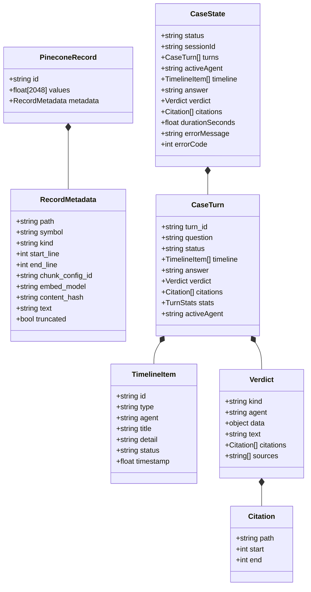
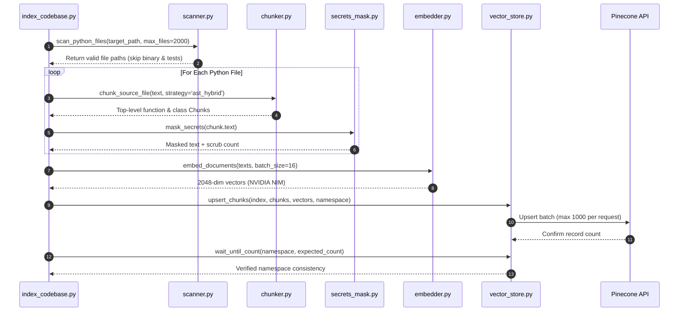
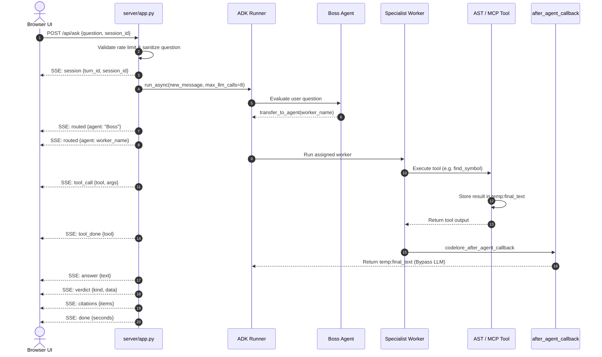
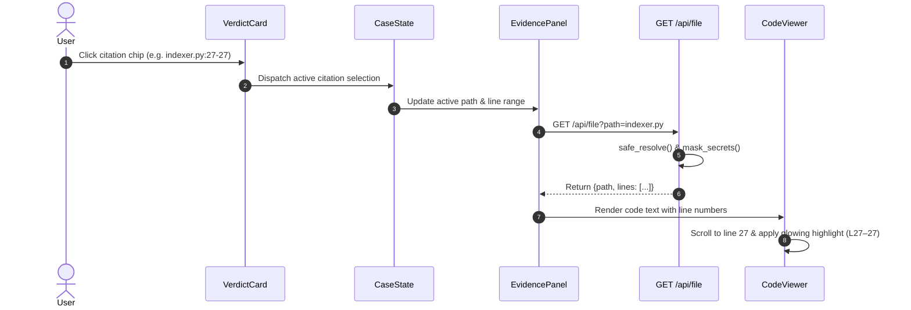
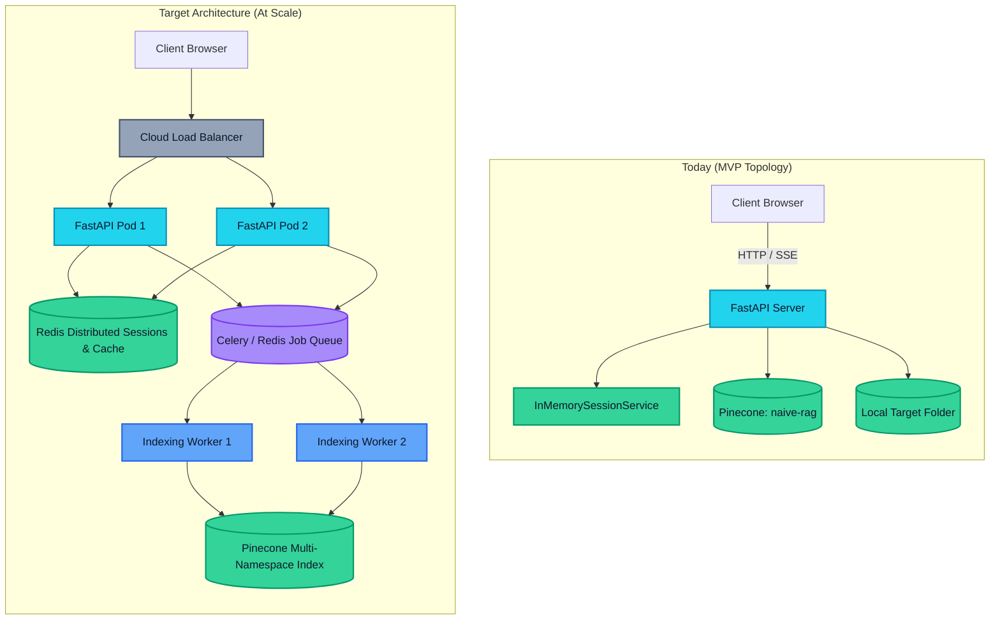

# System Design for Scale & Safety — CodeLore

> CodeLore provides a production-grade blueprint for scalable code intelligence, detailing data schemas, failure handling, STRIDE security controls, and evolutionary scaling from single-target MVP to enterprise multi-tenant infrastructure.

---

## Contents
- [Status](#status)
- [1. Requirements Matrix](#1-requirements-matrix)
- [2. Comprehensive Data Models](#2-comprehensive-data-models)
- [3. Core System Flows](#3-core-system-flows)
- [4. Scaling Architecture: Today vs At Scale](#4-scaling-architecture-today-vs-at-scale)
- [5. Reliability Engineering & Failure Modes](#5-reliability-engineering--failure-modes)
- [6. Security Architecture & Threat Model (STRIDE-Light)](#6-security-architecture--threat-model-stride-light)
- [7. Observability & Telemetry](#7-observability--telemetry)
- [8. Architectural Trade-offs](#8-architectural-trade-offs)
- [9. Future Work Roadmap (Phases 10–13)](#9-future-work-roadmap-phases-1013)
- [10. Cross References](#10-cross-references)

---

## Status

| Architectural Component | Status | Implementation Details |
| :--- | :---: | :--- |
| **AST-Hybrid Vector Schema** | **Built** | 2048-dim vectors with UTF-8 bounded metadata stored in Pinecone Serverless. |
| **In-Memory Rate Limiting** | **Built** | Sliding window rate limiter enforcing 8 requests / 10 minutes per client IP. |
| **Defensive Input Validation** | **Built** | Control char filtering, 500-char caps, and `safe_resolve` path security. |
| **Deterministic Error Recovery** | **Built** | Loop guards, model timeouts (90s), and fallback SSE error frames. |
| **STRIDE Threat Mitigations** | **Built** | Secret masking, forbidden file blacklists, and isolated MCP subprocess env. |
| **Distributed Session Store** | **Planned** | Redis-backed session persistence for horizontal container scaling (Phase 11). |
| **Asynchronous Task Queue** | **Planned** | Celery / Redis background workers for multi-repository indexing (Phase 12). |
| **Incremental Commit Indexing** | **Planned** | Git webhook processing re-indexing only modified AST chunks (Phase 12). |
| **Sandboxed Code Execution** | **Planned** | Ephemeral Firecracker / Docker microVM sandbox for proposed patches (Phase 13). |

---

## 1. Requirements Matrix

### Functional Requirements
- **FR-1 (Intent Routing)**: Direct questions accurately to one of 4 specialist agents based on query semantics.
- **FR-2 (AST Symbol Lookup)**: Identify exact class and function definition spans (`file.py:start-end`) without LLM hallucination.
- **FR-3 (Dependency Tracing)**: Extract and display all internal and third-party import edges between Python files.
- **FR-4 (Semantic Search)**: Retrieve code chunks matching natural language inquiries using calibrated similarity thresholds (`MIN_SCORE = 0.35`).
- **FR-5 (Real-Time Observability)**: Stream agent thoughts, tool dispatches, verdicts, and line citations to the web browser via SSE.

### Non-Functional Requirements & Design Targets
> [!NOTE]
> Latency values below represent architectural engineering goals, not empirical guarantees. Real-world speeds vary depending on upstream NVIDIA NIM queue depth.

- **NFR-1 (Latency Targets)**:
  - AST Symbol Lookups: Target `< 2.0 seconds` end-to-end.
  - Semantic Code Search: Target `< 5.0 seconds` end-to-end.
  - Deep Code Explanations: Target `< 60.0 seconds` under normal remote API conditions.
- **NFR-2 (Availability & Fault Isolation)**:
  - 99.9% API uptime goal; worker failures must yield structured error cards rather than terminating the server process.
- **NFR-3 (Cost & Token Efficiency)**:
  - Exact lookups bypass LLM text generation entirely; RAG search truncates chunk metadata to 8,000 bytes maximum.
- **NFR-4 (Security & Data Integrity)**:
  - Zero target code execution (`eval()`, `exec()`); strict read-only AST traversal and secret masking.

---

## 2. Comprehensive Data Models

*Figure 1 - Core data model: Pinecone vector record schema and React client CaseState domain model.*

### A. Vector Record Schema (Pinecone Serverless)
- **ID (`id`)**: SHA-256 hash of `{path}:{start_line}:{end_line}:{chunk_config_id}` (truncated to 32 characters).
- **Values (`values`)**: 2048-dimensional floating point array generated by `nvidia/nemotron-3-embed-1b`.
- **Metadata (`metadata`)**:
  - `path`: Target file path relative to repository root (e.g. `indexer.py`).
  - `symbol`: AST identifier name (e.g. `chunk_document`), or `module` / `window`.
  - `kind`: Structural AST category (`function`, `class`, `method`, `module`, `window`).
  - `start_line` / `end_line`: 1-based inclusive source code line numbers.
  - `chunk_config_id`: Parameter identifier (e.g. `ast_hybrid:60:8:3000`).
  - `embed_model`: Embedding model signature (`nvidia/nemotron-3-embed-1b`).
  - `content_hash`: SHA-256 digest of original chunk source text.
  - `text`: Safe chunk body, truncated to `METADATA_TEXT_MAX_BYTES = 8000`.
  - `truncated`: Boolean indicating whether metadata text was capped.

### B. Client Case & Investigation Domain Model
- **`CaseState`**: Root application state maintaining the history of turns, active agent, duration, and error codes.
- **`CaseTurn`**: An individual question-and-answer exchange with its own timeline, verdict, and citations.
- **`TimelineItem`**: Granular progress step (`routed`, `tool_call`, `tool_done`).
- **`Verdict`**: Final structured payload (`kind`: `symbol` | `outline` | `imports` | `overview` | `text` | `not_found`).
- **`SavedCase`**: Lightweight object stored in browser `localStorage` under `codelore_recent_cases` (max 20 entries).

---

## 3. Core System Flows

### Flow 1: Codebase Indexing Pipeline
The offline indexing pipeline prepares a target repository for vector retrieval.

*Figure 2 - Codebase indexing pipeline: from raw file scanning to Pinecone vector synchronization.*

---

### Flow 2: Live Question Turn Execution
The online query pipeline processes user inquiries via streaming Server-Sent Events.

*Figure 3 - Live question turn: multi-agent routing, tool execution, and streaming citation delivery.*

---

### Flow 3: Evidence Inspection & Code Highlighting
When a user clicks on an evidence chip, the UI fetches and highlights the verified line span.

*Figure 4 - Synchronized evidence inspection flow from verdict chip click to code highlighting.*

---

## 4. Scaling Architecture: Today vs At Scale

### Current MVP Architecture vs Target Enterprise Architecture

| Architectural Dimension | Current MVP Implementation | Target Enterprise Architecture (Planned) |
| :--- | :--- | :--- |
| **Workspace Target** | Single local directory (`TARGET_PROJECT_PATH`) | Multi-tenant GitHub repository auto-cloner (Phase 10) |
| **Vector Partitioning** | Fixed single namespace (`naive-rag`) | Dynamic Pinecone namespace per repository / commit |
| **Indexing Pipeline** | Synchronous local CLI (`index_codebase.py`) | Distributed Celery / Redis background workers (Phase 12) |
| **AST Analysis Cache** | Parsed on-demand per request | Redis cache for `/api/graph` and `/api/outline` |
| **Session State** | In-memory `InMemorySessionService` | Redis distributed session store across API instances |
| **Rate Limiting** | Single-node in-memory IP dictionary | Distributed Redis token bucket with per-user quotas (Phase 11) |
| **Compute Scaling** | Single FastAPI process | Kubernetes horizontal pod autoscaling (HPA) behind load balancer |

*Figure 5 - Topological evolution: from single-process MVP to distributed multi-pod infrastructure.*

---

## 5. Reliability Engineering & Failure Modes

### Reliability Parameters Configured in Code
- **Model Request Timeout**: `timeout=90s` (in `code_helper/agent.py` via `LiteLlm`).
- **Model Retry Limit**: `num_retries=1` to absorb transient connection drops.
- **Agent Call Ceiling**: `RunConfig(max_llm_calls=8)` in `server/app.py`.
- **Loop Guard Limit**: `loop_guard_before_tool_callback` blocks the 3rd invocation of any single tool or the 2nd call with identical arguments.
- **Client Rate Limit**: `RATE_LIMIT_WINDOW = 600.0s`, `MAX_REQUESTS_PER_WINDOW = 8` per IP address.
- **File Read Size Ceiling**: Maximum `300 KB` per file in `/api/file`.
- **Input Character Ceiling**: Maximum `500` characters for user questions.

### Comprehensive Failure Mode Matrix

| Failure Event | System Impact | Detection Mechanism | Mitigation & Recovery Strategy |
| :--- | :--- | :--- | :--- |
| **NVIDIA NIM Slow / Free-Tier Queuing** | Model calls hang or take minutes. | `timeout=90s` triggers LiteLLM exception. | Catch exception in `server/app.py`, emit `event: error` with `"The AI service is slow or busy. Try again."` code: `busy`. |
| **NVIDIA 429 Rate Limit Exhaustion** | Chat or embedding completions rejected. | Upstream HTTP 429 response status code. | Catch HTTP status, inform user via error card, and enforce client rate limits. |
| **Pinecone Cloud Outage** | Vector similarity lookups fail. | `VectorStoreError` raised in `search.py`. | Worker falls back to AST symbol search (`find_symbol`); logs error without crashing server. |
| **MCP Subprocess Crash / Disconnect** | `code_explainer` file read fails. | JSON-RPC Stdio pipe closed / EOF error. | Catch MCP error, fall back to native AST outline tools, and return error details gracefully. |
| **Directory Traversal Attack (`../`)** | Potential unauthorized file access. | `safe_resolve()` in `_paths.py`. | Raise `PathSecurityError`, immediately return `HTTP 400 Bad Request` before file access. |
| **Model Ignores Tool Output** | Runaway retrieval loops or false denials. | Repetitive tool calls detected in state history. | `loop_guard_before_tool_callback` halts execution; deterministic callback bypass delivers answer. |
| **Client Network Drop Mid-Stream** | Broken SSE pipe during multi-turn generation. | Client disconnect detected on ASGI event generator. | Event generator terminates cleanly; ADK in-memory session retains turn state for reconnect. |

---

## 6. Security Architecture & Threat Model (STRIDE-Light)

| STRIDE Category | Threat Description | Attack Vector | Security Control in Code | Implementation Status |
| :--- | :--- | :--- | :--- | :---: |
| **Spoofing** | Unauthorized API consumers impersonating legitimate users. | Direct HTTP requests bypass web UI. | Optional `X-Demo-Code` header validation against `DEMO_CODE` env var in `server/app.py`. | **Built** |
| **Tampering** | Path traversal to read arbitrary system files (e.g. `/etc/passwd` or `C:\Windows`). | Supplying `../../` in `/api/file` or tool arguments. | `safe_resolve()` in `code_helper/tools/_paths.py` strictly verifies resolved path is within target root. | **Built** |
| **Repudiation** | Actions taken without verifiable audit logs. | Unlogged API turns and tool invocations. | Turn IDs, tool calls, and timestamps emitted in SSE stream and printed to server stdout. | **Partly built** *(Persistent audit log planned)* |
| **Information Disclosure** | Secret keys or credentials exposed to LLM or browser. | Hardcoded tokens or `.env` files in target codebase. | 1. `mask_secrets()` regex redaction before embedding. 2. Sensitive file blacklist (`.env`, `.key`, `.pem`) in `server/app.py`. 3. Sanitized subprocess environment in `mcp_config.py`. | **Built** |
| **Denial of Service** | Flooding API with heavy queries to exhaust NIM credits. | Automated high-frequency HTTP requests. | In-memory IP rate limiter (`check_rate_limit`) capping requests at 8 per 10 minutes per IP. | **Built** |
| **Elevation of Privilege** | Arbitrary remote code execution via analyzed code. | Malicious Python scripts inside analyzed codebase. | CodeLore only reads ASTs and text; it never invokes `eval()`, `exec()`, or target scripts. | **Built** |

---

## 7. Observability & Telemetry

### What Is Monitored Today
- **Server Console Logs**: HTTP request methods, paths, status codes, and exceptions.
- **Live SSE Milestones**: Timestamps and execution durations for each `tool_call` and `tool_done` event.
- **Turn Statistics (`TurnStats`)**: Real execution duration in seconds (`stats.durationSeconds`) and count of verified evidence citations (`stats.evidenceCount`).
- **Tool Smoke Testing**: Automated verification logging 85 discrete checks across all target files.

### Planned Production Telemetry Additions
- **Distributed Request Tracing**: Integration of OpenTelemetry (OTel) traces across FastAPI, LiteLLM, and Pinecone calls.
- **Prometheus Metrics**: Exporting counters for `codelore_requests_total`, `codelore_tool_duration_seconds`, and `codelore_tokens_consumed`.
- **Structured Audit Logging**: Structured JSON logging capturing `turn_id`, `client_ip`, `worker_selected`, and `citations_returned`.

---

## 8. Architectural Trade-offs

| Architectural Choice | Primary Benefit | Inherent Cost / Trade-off |
| :--- | :--- | :--- |
| **Deterministic Callback Bypass** | Guarantees 100% citation accuracy on lookups; completely eliminates small-model hallucinations and loops. | Answers are structured, exact tool outputs without conversational prose or narrative synthesis. |
| **AST Parsing over Full Execution** | 100% safe; zero vulnerability to malicious code execution during analysis. | Cannot evaluate dynamic runtime properties, metaprogramming, or dynamically generated imports. |
| **Custom RAG vs Framework (LangChain)** | Zero dependency bloat; sub-18s test execution; complete visibility and control over pipeline. | Requires maintaining custom chunking, secret masking, and Pinecone upsert logic. |
| **Server-Sent Events vs WebSockets** | Simple HTTP infrastructure; automatic browser reconnect; seamless traversal through reverse proxies. | Unidirectional server-to-client streaming; client cannot send messages over the same stream channel. |
| **In-Memory Rate Limiting** | Zero external infrastructure requirements (no Redis dependency in MVP). | State is lost on server restart; cannot be shared across multiple horizontal container replicas. |

---

## 9. Future Work Roadmap (Phases 10–13)

### Phase 10: External Repository Importer & Sanitizer
The importer pipeline will allow users to submit any public GitHub repository URL. The backend clones the repository into an isolated workspace directory, applies automated scrubbing to strip `.env`, `.pem`, and credential files, and triggers the `index_codebase.py` AST scanner and vector upsert pipeline into an isolated Pinecone namespace.

### Phase 11: Multi-User Authentication & Resource Quotas
Integration with Firebase Authentication or OAuth 2.0 (GitHub / Google) to manage user identities. Introduces a persistent PostgreSQL database for user profiles, API keys, and investigation case history, accompanied by token-bucket rate limits and monthly query budgets per user tier.

### Phase 12: Asynchronous Job Queue & Incremental Re-Indexing
Decouples indexing from the API process using Celery workers backed by Redis. Adds GitHub webhook handlers that listen for `git push` events, inspect the commit diff, and incrementally re-index only the modified AST functions and classes, eliminating the cost of full-repository re-indexing.

### Phase 13: Sandboxed Code Editing & Patch Verification
Extends CodeLore from a read-only assistant to an active pair programmer. When a fix is discussed, the agent generates a code patch and applies it within an ephemeral Docker or Firecracker microVM sandbox, executing the repository's test suite to verify the proposed fix before presenting a pull request to the developer.

---

## 10. Cross References

- Product Requirements & Success Metrics: [docs/PRD.md](file:///d:/CodeLore/codelore/docs/PRD.md)
- Complete System Architecture & Agent Design: [docs/ARCHITECTURE.md](file:///d:/CodeLore/codelore/docs/ARCHITECTURE.md)
- MVP Specifications, API Reference & Runbook: [docs/MVP_TECH.md](file:///d:/CodeLore/codelore/docs/MVP_TECH.md)
- Engineering Post-Mortem on Looping: [docs/problem_and_fix.md](file:///d:/CodeLore/codelore/docs/problem_and_fix.md)
- Empirical Known Limitations & Bottlenecks: [docs/known_limitations.md](file:///d:/CodeLore/codelore/docs/known_limitations.md)
- Real Sample Evaluation QA Transcripts: [docs/sample_qa.md](file:///d:/CodeLore/codelore/docs/sample_qa.md)
